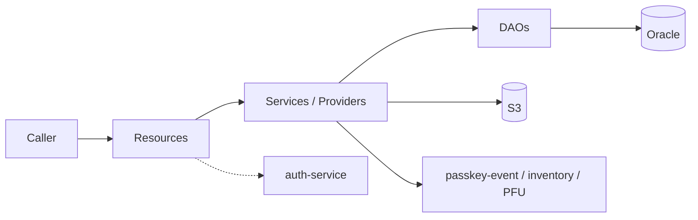

# Architecture

## Summary

A single Dropwizard process ("passkey-eventhousing-service") with a classic three-layer design: **JAX-RS resources → services/providers → MyBatis DAOs**, plus Retrofit2 clients for downstream Passkey services and the AWS SDK for S3. There is **no dependency-injection framework**; every object is constructed by hand in `PasskeyEventHousingServiceApplication.run()`.

- System view: [diagrams/system-architecture.mmd](diagrams/system-architecture.mmd)
- Component wiring: [diagrams/component-relationships.mmd](diagrams/component-relationships.mmd)
- Request pipeline: [diagrams/api-request-flow.mmd](diagrams/api-request-flow.mmd)

## Layers

### 1. Bootstrap — `PasskeyEventHousingServiceApplication`

Verified in [PasskeyEventHousingServiceApplication.java](../passkey-event-housing-service/src/main/java/com/cvent/passkeyeventhousing/PasskeyEventHousingServiceApplication.java):

| Step | Lines | What happens |
|---|---|---|
| Logging context | 99, 184+ | `initializeLoggingContext` registers `LogContextFeature` handlers (eventId/hotelId path params; request types `GroupLinkSetupRequest`, `RoomBlockTransferStateRequest`, `CategoryRequest`, `AssignedRoomRequest`, `ConnectionRequest`) |
| Auth | 101 | `CventAuthFeature` (remote auth against auth-service) |
| Clients | — | `ClientCreator` builds all Retrofit2 clients |
| DB | — | `SessionFactoryCreator` builds the MyBatis `SqlSessionFactory`; a `TransactionManager` wraps it |
| DAOs | 114–125 | 11 DAOs (7 on `TransactionManager`, 4 on raw `SqlSessionFactory`) |
| Services/Providers | 127–155 | Services, providers, `S3Client` (region `US_EAST_1`) |
| Jersey registration | 158–173 | Exception mappers + 9 resources |
| Health | 176 | `PasskeyEventHousingHealthCheck` (always healthy) |

Application policy: `CventApplicationPolicyType.Api`. Confidence High.

### 2. Resources (`resources/`)

9 registered JAX-RS resources. All endpoints except `POST /events/{eventId}/images/pfu` require `@Authority(methods = API_KEY)`; `GET /events/{eventId}/blocks-summary` also accepts `BEARER`. See [api-reference.md](api-reference.md).

### 3. Services & Providers (`service/` package — providers share it)

- **Services** hold business rules and DB orchestration. Those extending `AbstractService` can group DAO calls in one session via `executeInSameDbSession` (used by `HotelDetailsService`, `RoomDetailsService`, `ImageService.deleteImage`).
- **Providers** wrap remote clients: `EventProvider`, `InventoryProvider`, `MessageProvider`, `ImageProvider`, `PfuFileProvider`. Most use `ClientUtil.getOrFail()` which converts failures to `WebApplicationException` (downstream status preserved, otherwise 500).

### 4. Data access (`passkey-event-housing-data-access`)

- MyBatis mapper interfaces + XML SQL (12 mappers) against Oracle.
- `AbstractDao<S>` resolves the mapper class from the generic type and runs calls in the ambient session when present, else a new auto-commit session ([AbstractDao.java](../passkey-event-housing-data-access/src/main/java/com/cvent/passkey/eventhousing/dataaccess/AbstractDao.java)).
- `TransactionManager` stores one `SqlSession` in a `ThreadLocal`; `within()` opens a non-auto-commit session, commits on success, rolls back on exception ([TransactionManager.java](../passkey-event-housing-data-access/src/main/java/com/cvent/passkey/eventhousing/transaction/TransactionManager.java)).
- Four DAOs bypass this: `ConnectionDataAccess`, `AdminDataAccess`, `GroupLinkDataAccess`, `RoomCategoriesDataAccess` take the raw factory and manage sessions per method. See [technical-decisions.md](adr/003-threadlocal-transaction-manager.md).

## Transaction boundaries (verified)

| Operation | Atomic? | Why |
|---|---|---|
| Hotel / room reads | n/a (single read session) | `executeInSameDbSession` |
| `ImageService` delete + renumber | Yes | `executeInSameDbSession` (ImageService.java:197) |
| Connection link / delete | Yes | Explicit `openSession()` + `commit`/`rollback` in `ConnectionDataAccess` (lines 92–141, 208–256) |
| GroupLink setup (transfer defs, approve, mappings, blocks) | **No** | Each `GroupLinkDataAccess` write uses its own `openSession(true)` |
| Room-category multi-step ops (e.g. delete category + images) | **No** | `RoomCategoriesDataAccess.update` commits per call |
| Admin participant association loop | **No** (per participant) | `AdminService` loops; each call commits separately |
| Image save (DB + S3) | Compensating | DB row deleted if S3 upload fails |

## Cross-cutting concerns

| Concern | Implementation | Source |
|---|---|---|
| Authentication | `CventAuthFeature.forRemoteAuth`, `@Authority` param annotations | Application line 101 |
| Error handling | `EventHousingExceptionMapper`, `DaoExceptionMapper`, `GroupLinkExceptionMapper`, `JerseyViolationExceptionMapper`, `WebApplicationExceptionMapper`, `InvalidFilterFieldExceptionMapper` → `ErrorResponse {errorCodeType, httpRequestId}` | `exceptions/` |
| Logging context | `LogContextFeature` → MDC | Application line 184 |
| Metrics | `@Timed` / `@ExceptionMetered` on some `EventResource` methods only | `EventResource.java` |
| Filtering | `FilterConverter` + `RoomTypesFilterPredicateValidator` (fields `attendeeTypes.id`, `attendeeTypes.codes`, `EQ` only) | `pagination/filters/` |
| Retry | `RetryInterceptor` on Retrofit clients | `ClientCreator.java:63` |

## Runtime topology

- Deployed as a container on Cvent's AWS platform via the `dropwizardPipeline` Jenkins library; autoscaling 2–8 instances at 70% CPU in pr50/sg50 ([deployment-operations.md](deployment-operations.md)).
- Not internet-facing (`internet_facing=false` in [base.properties](../passkey-event-housing-service/configs/base.properties)).
