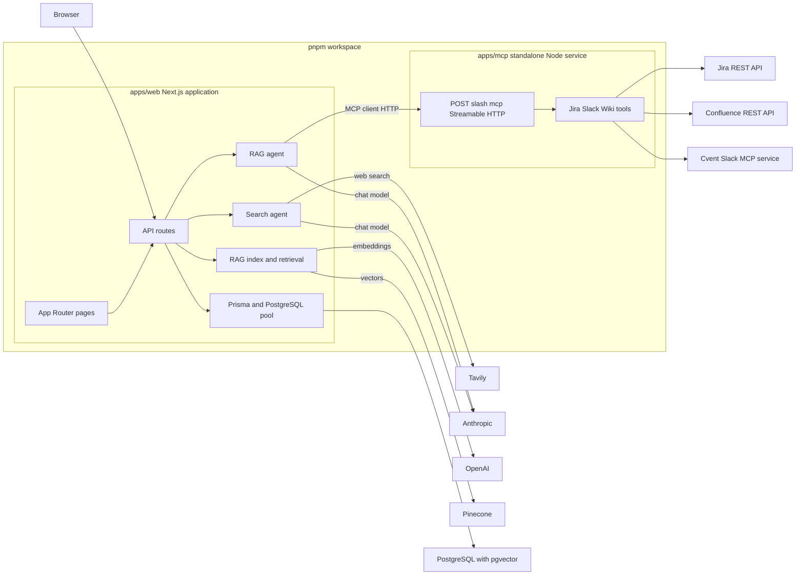

## At a glance

This repository is a two-application pnpm workspace, not a single deployable process. `apps/web` (`@deepagents/web`) is the user-facing Next.js application and hosts its own API routes, agents, persistence access, and RAG indexing/search logic. `apps/mcp` (`@deepagents/mcp`) is an independently started Node/Express MCP server that exposes enterprise connectors over HTTP. The root scripts select either package with pnpm filters; there is no workspace library package shared by the two applications.

The boundary between them is **Streamable HTTP MCP**. The web application reads a server declaration from `.vscode/mcp.json` (or `MCP_CONFIG_PATH`), then connects to the configured URL as an MCP client. The checked-in local declaration targets `http://127.0.0.1:8787/mcp`. Consequently, starting the web app does **not** start the connector service, and deployment must supply a reachable MCP endpoint separately.



The diagram shows the implemented runtime dependencies and the HTTP-only MCP boundary. The resume tailoring route also calls Anthropic directly; its profile-vector persistence is a separate capability rather than part of the shown chat path.

## Workspace and entry points

`pnpm-workspace.yaml` includes `apps/*`, yielding exactly `@deepagents/web` and `@deepagents/mcp`. From the repository root, use `pnpm dev:web`, `pnpm build:web`, `pnpm start:web`, and `pnpm lint:web` for the web package; use `pnpm dev:mcp` or its alias `pnpm mcp:server` for the MCP package. The MCP package's `dev` script is `node server.mjs`, so `apps/mcp/server.mjs` is the service entry point. The web package uses the normal `next dev`, `next build`, and `next start` lifecycle.

The App Router root layout supplies navigation to `/search`, `/rag`, `/resume`, and `/manage/rag`; the home page directs users to those flows. The primary server-side entry points are route handlers under `apps/web/app/api`:

- `/api/chat/search` validates a non-empty prompt, persists user and assistant messages, then invokes the web-search agent.
- `/api/chat/rag` validates a prompt and invokes a lazily initialized RAG agent.
- `/api/manage/rag` starts knowledge-base indexing; its module-level promise rejects concurrent indexing with HTTP 409.
- `/api/manage/wiki` validates a numeric Confluence parent ID and calls `get_wiki_content` through the MCP client, always closing the client connection.
- `/api/resume/tailor` makes a direct Anthropic request against the bundled candidate profile. It is separate from both RAG and MCP.

Search conversation storage currently uses `local-user` as the default identity. A supplied conversation ID is accepted as-is after CUID validation; the route does not establish user ownership or authentication. Treat this as a local/demo persistence model, not a multi-tenant authorization boundary.

## Web runtime responsibilities

### Search and model calls

The search route invokes a singleton DeepAgents agent built with Anthropic model `claude-haiku-4-5-20251001` and the `internet_search` tool. That tool instantiates Tavily with `TAVILY_API_KEY`; the agent therefore depends on both Anthropic model availability and Tavily search availability. Agent invocation failures are caught by the route, which still writes an assistant message containing a fixed fallback response. Errors outside that inner invocation—for example JSON, database, or persistence failures—return HTTP 500.

The RAG agent is created once per web-process lifetime via a cached promise. It uses `claude-sonnet-4-6`, `document_search`, a `StateBackend`, and tools loaded from the configured MCP server. Its instructions require retrieval before evidence-based answers, save retrieved chunks under `/retrieved/`, and delegate per-chunk analysis to at most three `chunk-analyst` subagents. Agent construction loads MCP tools, so an unavailable or misconfigured MCP server prevents RAG agent initialization and causes the RAG route to return HTTP 500.

`next.config.ts` marks the agent/model/MCP packages as server external packages. This is a deployment/build constraint: agent code and its Node-oriented dependencies execute on the server, not in the browser bundle.

### Knowledge-base ingestion and retrieval

RAG source selection is constrained to `docs` at the repository root. `.` and related spellings mean the whole directory; path resolution rejects an attempted escape from it. A normal subdirectory indexes readable local files, while `docs/remote` (or one of its descendants) treats JSON files containing `sources` arrays as metadata and fetches those URLs. Indexing the whole `docs` directory includes both local material and remote metadata sources. Failed directory reads, malformed metadata, unreadable files, and unsuccessful remote fetches are skipped where the loader can continue; an empty resulting source set is an error.

Each source is split into 1,000-character chunks with 200-character overlap and embedded with OpenAI `text-embedding-3-small` at 1,024 dimensions. Chunks live in Pinecone index `aoe-langchain-docs`, namespace `documents`. A separate `rag-manifest` namespace stores the source hash and chunk IDs: unchanged sources are skipped, and previous chunks are deleted before a changed source is reinserted. `document_search` performs a four-result similarity search and uploads Markdown-wrapped chunks into the agent backend; it returns their paths rather than raw content so the subagent can inspect them.

### Relational persistence and pgvector capability

The web database adapter requires `DATABASE_URL` at module load, creates a `pg` pool, and gives it to Prisma through `@prisma/adapter-pg`. The schema persists conversations/messages and also defines candidate profiles, job descriptions, and `SemanticChunk` rows with `vector(1024)` embeddings. The supplied compose configuration runs PostgreSQL 17 with pgvector on host port `5433` and persists its data in the `deepagents-pgvector-data` volume. This database is distinct from Pinecone: conversation history uses PostgreSQL, while knowledge-base RAG uses Pinecone.

A `resumeTailor` tool can split the embedded candidate profile, obtain the same OpenAI embeddings, and transactionally replace its stored profile chunks in PostgreSQL. However, the browser resume route currently invokes Anthropic directly and does not call that tool, so profile-vector indexing is an available backend capability, not a prerequisite for resume tailoring.

## MCP service boundary and lifecycle

`server.mjs` loads environment variables and listens on `MCP_HOST` (default `0.0.0.0`) and the first available value of `PORT`, `MCP_PORT`, or `8787`. It exposes:

- `POST /mcp` for the MCP protocol;
- `GET /` returning `200 {"status":"healthy"}` for health checks; and
- `GET /mcp` and `DELETE /mcp`, both returning JSON-RPC method-not-allowed errors.

Every `POST /mcp` builds a new `McpServer`, registers the Jira, Slack, and Wiki tools, and attaches a `StreamableHTTPServerTransport` with `sessionIdGenerator: undefined`. This deliberately makes the transport stateless per HTTP request. On response close it closes both transport and server. Handler exceptions are logged and become JSON-RPC internal errors when response headers have not already been sent. Connector or enterprise-service state is therefore not shared in the MCP service process between requests.

The web client searches `MCP_CONFIG_PATH`, then `.vscode/mcp.json` relative to its working directory, then the workspace-root form. It supports only `http` configurations, passes configured headers into the HTTP transport, and closes an unsuccessfully connecting client before rethrowing. `loadMcpClientConfig()` turns all configured servers into the LangChain MCP adapter configuration; the RAG agent loads the exposed tool set from that configuration without prefixing tool names. Adding an MCP server is configuration-driven, but duplicate tool names across servers would be ambiguous because prefixes are disabled.

## Enterprise connector dependencies

The standalone service is the credential boundary for Jira and Confluence: its tools read credentials from its own environment, not tool arguments.

- **Jira:** `get_jira_ticket` requires `JIRA_BASE_URL` and `JIRA_BEARER_TOKEN`, validates the issue-key shape, requests a selected field set from Jira REST API v2, and removes all `avatarUrls` recursively before returning text and structured content. Non-success Jira responses surface status and response detail as errors.
- **Confluence:** `get_wiki_content` defaults to `https://wiki.cvent.com`, supports bearer credentials or Basic credentials via `WIKI_AUTH_TYPE`, traverses all descendants breadth-first with pagination, fetches each page's storage body, and writes one `wiki-{id}.md` file per page to `WIKI_OUTPUT_DIR` or the MCP process working directory. The returned combined content is parent first; file-writing makes this tool stateful with respect to its filesystem even though the HTTP transport is stateless.
- **Slack:** `search_slack_messages` is a proxy to a separate Cvent Slack MCP endpoint (or `SLACK_MCP_URL`). It requires keywords or a filter, connects for each call, verifies that the remote service exposes `slack_search_public_and_private`, forwards only defined arguments, and closes the remote client and transport in `finally`.

See [MCP Service and Connectors](../integrations/mcp-service-and-connectors.md) for connector-specific behavior and credentials.

## Configuration, deployment, and operational checks

At minimum, the web process needs `DATABASE_URL`; its optional feature paths additionally need provider credentials such as `ANTHROPIC_API_KEY`, `TAVILY_API_KEY`, `OPENAI_API_KEY`, and `PINECONE_API_KEY` as applicable. RAG must have OpenAI and Pinecone credentials and an accessible MCP declaration. The MCP process needs its connector credentials only for the tools used, plus `PORT`/`MCP_PORT`/`MCP_HOST` when defaults are unsuitable. Do not copy secret-bearing `.env` files into client-visible configuration.

The MCP Dockerfile is an independent Node 22 Alpine build: it installs production dependencies inside `apps/mcp`, runs as the non-root `node` user, sets `PORT=8080`, exposes 8080, and health-checks `GET /`. This fits a Cloud Run-style deployment but does not bundle the web application. **Current build caveat:** the runtime stage copies `server.mjs`, `client.mjs`, and `package.json`, but not the `tools/` directory that `server.mjs` imports. As written, the built image will be unable to resolve those modules at startup; copy `tools/` into the runtime image before treating the container command as deployable.

Use the following focused checks after topology or configuration changes:

```bash
pnpm install
pnpm lint:web
pnpm build:web
pnpm dev:mcp
```

With the MCP service running, `pnpm --filter @deepagents/mcp test list` validates the HTTP handshake and tool discovery; it uses `MCP_SERVER_URL` when set and otherwise `http://127.0.0.1:8787/mcp`. A health probe to `/` distinguishes basic service availability from connector credentials and upstream access. For the RAG and database setup sequence, see [RAG Knowledge Base](../workflows/rag-knowledge-base.md); for chat persistence, see [Search Conversations](../workflows/search-conversations.md); and for deployment details, see [Configuration, Deployment, and Validation](../operations/configuration-deployment-and-validation.md).
