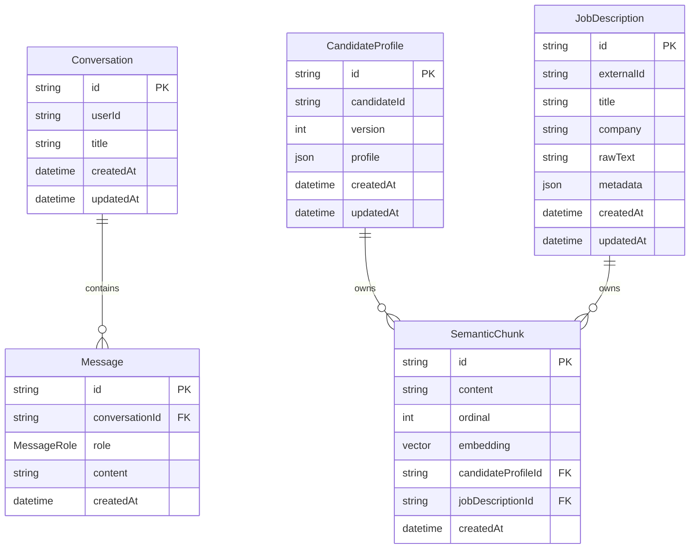

The web application has **two separate persistence planes**. PostgreSQL, accessed through Prisma and `DATABASE_URL`, is the system of record for search conversations and messages and has a pgvector-backed candidate-profile indexing capability. Pinecone is the active retrieval store for the documentation knowledge base used by the RAG agent. These are not replicas of one another: a Pinecone RAG reindex does not populate `SemanticChunk`, and candidate-profile indexing does not write Pinecone.

## Ownership at a glance

```mermaid
flowchart TD
    ChatAPI["Search and history API"] --> Prisma["Prisma with pg adapter"]
    ResumeIndexer["index_candidate_profile tool"] --> OpenAI["OpenAI embeddings"]
    ResumeIndexer --> Prisma
    Prisma --> Postgres["PostgreSQL with pgvector"]
    RAGAdmin["RAG management API"] --> RAGIndexer["Knowledge base indexer"]
    RAGIndexer --> OpenAI
    RAGIndexer --> PineconeDocs["Pinecone documents namespace"]
    RAGIndexer --> PineconeManifest["Pinecone rag-manifest namespace"]
    RAGAgent["RAG agent document_search"] --> PineconeDocs
```

This shows the runtime storage boundary: PostgreSQL owns relational history and optional resume vectors, whereas Pinecone owns documentation RAG vectors and its ingestion manifest.

| Concern | Authoritative store | Current writer/reader | Important boundary |
| --- | --- | --- | --- |
| Search conversations and messages | PostgreSQL | chat search and history routes through `lib/db` | Not an authorization system: the default identity is `local-user`, and message lookup accepts a valid conversation ID without checking its `userId`. |
| Candidate profile and evidence chunks | PostgreSQL with pgvector | `index_candidate_profile` tool writes them | This is an available indexing capability, not the browser resume-tailoring path. |
| Job descriptions and their chunks | PostgreSQL schema only | No current application writer or reader | The tables and relations are provisioned for future use, but no retrieval workflow currently uses them. |
| Documentation knowledge base | Pinecone index `aoe-langchain-docs` | `indexKnowledgeBase` writes; `document_search` reads | This is the live RAG corpus, not PostgreSQL `SemanticChunk`. |
| RAG source manifest | Pinecone namespace `rag-manifest` | `indexKnowledgeBase` reads and writes | Stores source hashes and the document-vector IDs needed to replace changed sources. |

## Relational model

The Prisma schema defines application-facing models; committed SQL migrations define the physical PostgreSQL objects, including the `vector` extension and the HNSW index. IDs for Prisma-managed conversation and model records default to CUIDs. The candidate indexer deliberately supplies UUIDs for profile and chunk rows through raw SQL, which remains valid because the database columns are `TEXT`.

This ER diagram shows the declared relational ownership. `SemanticChunk` has two *independently nullable* foreign keys; the database does not enforce exactly one owner. Thus the model permits a chunk with neither owner or with both owners. Current candidate indexing populates only `candidateProfileId`.

### Chat history

`Conversation` contains the user association, optional title, and creation/update timestamps. `Message` has one required conversation, a required `content`, creation time, and a `MessageRole` enum of `user`, `assistant`, `system`, or `tool`. The APIs that currently create messages restrict roles to `user` and `assistant`, and history reads similarly filter to those two roles; the other enum values are schema capacity rather than current UI history behavior.

The default database helpers use `local-user`. `getOrCreateConversation()` selects that user’s most recently updated conversation or creates one titled `Search Conversation`; the search endpoint instead creates a titled conversation from its first input when no ID is supplied. Supplying an existing CUID only avoids creation—it does **not** prove that the conversation exists or belongs to the caller. A nonexistent ID will fail later at the message foreign key.

A subtle ordering constraint matters for safe changes: message insertion does not update the parent conversation. `Conversation.updatedAt` is maintained only when the `Conversation` row itself is written, so `listConversations()` orders by a value that is not advanced by the current `createMessage()` helper. Do not assume a conversation with a new message automatically rises to the top of that list; introduce an explicit parent update if that is required.

### Candidate, job, and semantic records

`CandidateProfile` stores an opaque JSONB profile and is versioned by the unique pair `(candidateId, version)`. `JobDescription` can store an external ID, descriptive fields, raw text, optional JSONB metadata, and timestamps. `SemanticChunk` stores chunk text, its ordinal, a required `vector(1024)` embedding, and timestamps. The Prisma type for `embedding` is `Unsupported("vector(1024)")`, so vector reads/writes requiring a native pgvector representation are handled with raw SQL rather than ordinary Prisma model operations.

`indexCandidateProfile(version)` constructs evidence documents from the bundled profile, splits them at 1,000 characters with 200-character overlap, and embeds all chunks using `text-embedding-3-small` at 1,024 dimensions. Within one Prisma transaction it upserts the `(candidateId, version)` profile, deletes the stored profile’s prior chunks, then inserts replacement chunks in ordinal order, casting JSON vector values to `vector`. A missing generated vector throws before the corresponding insert; a failed transaction prevents its intermediate delete/upsert/inserts from committing.

The upsert’s `RETURNING id` is significant: on conflict, the code retains the existing profile ID rather than the generated candidate ID, deletes chunks attached to that stored ID, and replaces them. Any new indexing implementation must preserve that relationship or it can leave stale chunks behind.

## Database invariants and indexes

The following are migration-enforced properties, rather than conventions in application code:

- Deleting a `Conversation` cascades to its `Message` rows. Deleting a `CandidateProfile` or `JobDescription` cascades to chunks that reference it. Foreign-key updates cascade too.
- `CandidateProfile(candidateId, version)` is unique. It is the conflict target used by candidate re-indexing.
- `(userId, updatedAt)` supports selecting/listing a user’s conversations in recency order; `(conversationId, createdAt)` supports ordered message history.
- `(candidateId, updatedAt)`, `(company, createdAt)`, and each owner-plus-ordinal pair support their respective profile, job, and ordered-chunk access patterns.
- `SemanticChunk.embedding` has an HNSW index using `vector_cosine_ops`. The index makes cosine similarity queries possible at the database layer, but the current application contains no pgvector similarity query. Do not claim the resume route or RAG agent currently retrieves from this index.

The initial chat migration creates the enum, tables, indexes, and message foreign key. The later resume migration runs `CREATE EXTENSION IF NOT EXISTS vector`, adds candidate/job/chunk tables, their relational indexes and foreign keys, and the HNSW vector index. Deploy schema changes through Prisma’s migration configuration at `apps/web/prisma/migrations`; changing only `schema.prisma` does not provision extension-dependent database objects.

## Active Pinecone knowledge-base lifecycle

The RAG indexer resolves a requested folder beneath repository `docs`; attempts to escape that directory are rejected. Local files become source documents, while `docs/remote` metadata supplies URLs to fetch. Each source is hashed with SHA-256. Its source-string hash is the manifest ID, and the source-content hash determines whether the source is unchanged.

For a changed source, the indexer deletes the old document vector IDs recorded in `rag-manifest`, splits content into the same 1,000/200 chunks, and writes the new vectors to the `documents` namespace in batches of eight. It waits ten seconds between non-final batches. It then upserts a manifest record containing `{ source, hash, chunkIds }` and a fixed 1,024-dimensional marker vector. An unchanged manifest hash skips the source entirely. This gives replacement behavior for a source that is reprocessed; it does **not** sweep manifest entries or vectors for sources removed from the selected folder.

`document_search` lazily constructs a Pinecone-backed store with the same 1,024-dimensional OpenAI embedding model, performs `similaritySearch(query, 4)` in `documents`, and uploads wrapped results to the DeepAgents `StateBackend`. The tool returns those temporary `/retrieved/...` paths, not PostgreSQL chunks or the raw search payload.

The indexing API allows only one in-process run via a module-level promise and returns HTTP 409 for a concurrent request. That lock is process-local, so it should not be treated as distributed coordination across multiple web instances.

## Operations and change guidance

### Connection and local database

`lib/db/prisma.ts` reads `DATABASE_URL` when loaded and throws if it is absent. It creates a `pg` `Pool`, wraps it in `PrismaPg`, and caches the `PrismaClient` on `global` outside production to avoid development hot-reload client proliferation. Prisma CLI configuration reads the same variable and locates both the schema and migration directory.

For the supplied local setup, `docker-compose.pgvector.yml` runs `pgvector/pgvector:pg17`, maps host port `5433` to PostgreSQL `5432`, persists data in `deepagents-pgvector-data`, and health-checks with `pg_isready`. The example database URL targets that port. The service image is important: a plain PostgreSQL instance may not be able to apply the pgvector migration.

The RAG path separately requires `PINECONE_API_KEY`; construction fails without it. Embedding operations require the OpenAI configuration used by `OpenAIEmbeddings`. Keep database connection credentials and provider keys server-side.

### What to test

There are no repository-owned automated tests for this persistence path; the web package exposes lint and build scripts, not a test script. Focus validation on the behavior that can silently corrupt ownership or leave stale retrieval data:

1. Apply migrations to a fresh pgvector-enabled database, then verify `vector` exists, `SemanticChunk.embedding` is `vector(1024)`, and the HNSW cosine index exists.
2. Create a conversation with messages, delete the conversation, and assert child messages are deleted. Also verify that an attempt to create a message for an absent conversation fails by foreign key.
3. Index the same candidate and version twice; assert one profile remains, its returned ID is stable, and chunks are replaced rather than accumulated. Verify every stored vector has 1,024 dimensions and only the expected owner FK is populated.
4. Index an unchanged documentation source twice and assert the second pass skips it. Change that source and verify old `chunkIds` are deleted before the manifest references replacements. Test a removed source explicitly if deletion from the index is a requirement, because the current lifecycle does not perform that cleanup.
5. Run `pnpm lint:web` and `pnpm build:web` after schema, raw SQL, or dependency changes. Exercise the deployed topology with actual PostgreSQL, OpenAI, and Pinecone credentials because build success cannot verify extension availability or remote index compatibility.

## Related workflows

- [Configuration, Deployment, and Validation](../operations/configuration-deployment-and-validation.md) covers environment and operational checks.
- [RAG Knowledge Base](../workflows/rag-knowledge-base.md) covers source selection, index management, and retrieval use.
- [Resume Tailoring](../workflows/resume-tailoring.md) distinguishes the direct tailoring endpoint from optional profile-vector indexing.
- [Search Conversations](../workflows/search-conversations.md) covers the API-level history lifecycle and its present local/demo ownership model.
