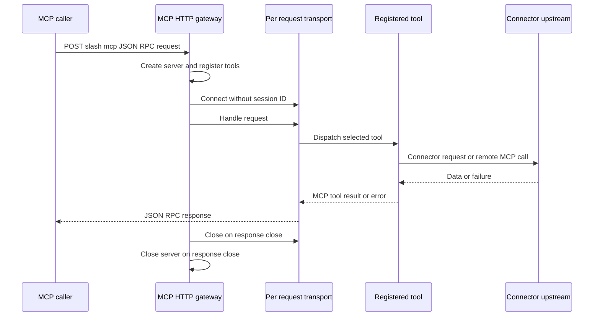
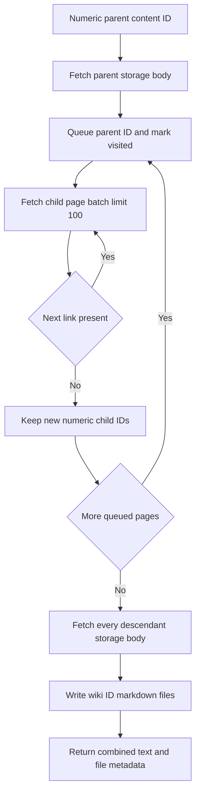

## Scope and boundary

`apps/mcp` is a standalone Node service that presents three enterprise integrations as MCP tools: `get_jira_ticket`, `search_slack_messages`, and `get_wiki_content`. It is separate from the Next.js application. The checked-in `.vscode/mcp.json` declares the local HTTP endpoint as `http://127.0.0.1:8787/mcp`; a deployed web process must instead be given configuration that reaches its separately deployed gateway.

The gateway is deliberately **stateless at the MCP transport layer**. Each `POST /mcp` creates a fresh `McpServer`, registers all tools, connects a `StreamableHTTPServerTransport` with no session ID generator, dispatches the request, and closes both objects when the response closes. This means there is no reusable MCP session or connector client retained across gateway requests. It does not mean tools cannot have side effects: the wiki tool writes exported files, and every connector uses upstream services or credentials.



This diagram shows the per-request MCP dispatch lifecycle and the tool boundary to an external system.

## Gateway endpoints and failure boundary

The process listens on `MCP_HOST` (default `0.0.0.0`) and picks `PORT`, then `MCP_PORT`, then `8787`. `POST /mcp` is the protocol endpoint. `GET /` returns `200` with a health payload, while `GET /mcp` and `DELETE /mcp` return JSON-RPC method-not-allowed errors. An exception in the POST handler is logged and, if headers have not been sent, becomes a JSON-RPC internal error (`-32603`).

The gateway code does not add HTTP authentication or authorization middleware. In particular, connector credentials protect the gateway-to-upstream calls, not caller access to `/mcp`. Place the service behind an appropriate network and/or authentication boundary when it is not a local-only service.

## Clients and server selection

### Standalone CLI client

`apps/mcp/client.mjs` is both the package's `test` script and a practical smoke client. It loads `.env`, connects a Streamable HTTP MCP client to `MCP_SERVER_URL` or the local default, calls `listTools`, and either displays tool names or calls the selected tool. The selectors `jira`, `wiki`, and `slack` map to the three canonical tool names; callers can instead provide a JSON object that conforms to the selected tool's schema. It rejects an unrecognized selector, a missing advertised tool, malformed non-object JSON arguments, or a tool response marked `isError`; it sets a nonzero exit code and closes its client and transport in all cases.

Run the server and discovery check from the repository root:

```bash
pnpm mcp:server
pnpm --filter @deepagents/mcp test list
```

Examples from `apps/mcp` are:

```bash
pnpm test jira GROUP-132015
pnpm test wiki 1106609325
pnpm test slack XSS acknowledgement email
pnpm test search_slack_messages '{"keywords":["XSS"],"response_format":"concise"}'
```

With no positional argument, the CLI supplies `JIRA_ISSUE_KEY` or `WIKI_CONTENT_ID` (with built-in example defaults) for Jira and Confluence. Slack has no default query and requires keywords or a filter.

### Web client and configuration contract

The web-side client reads the first readable path in this order: `MCP_CONFIG_PATH`, `.vscode/mcp.json` below the current working directory, then `../../.vscode/mcp.json`. A configuration may use either `servers` or `mcpServers`; the selected server must have type `http` (or omit the type, which defaults to HTTP), a URL, and optional request headers. `MCP_SERVER_NAME` selects a named server; otherwise the first configured server is used. Configured headers are passed to the Streamable HTTP transport.

`loadMcpClientConfig()` converts every configured server into the LangChain multi-server client format with `throwOnLoadError: true` and `prefixToolNameWithServerName: false`. The RAG agent loads those exposed MCP tools during its creation, so a bad MCP configuration or unreachable gateway prevents RAG-agent initialization. Because tool-name prefixes are disabled, do not configure servers that expose colliding tool names.

For direct wiki management, `POST /api/manage/wiki` validates a numeric `contentId`, connects through `createMcpClient()`, calls `get_wiki_content`, returns its parent ID, descendant IDs, and file metadata, then closes the connection in `finally`. Invalid JSON or an invalid ID yields HTTP 400; MCP/configuration/upstream failures are presented by this web route as HTTP 500 with a generic error and detail.

## Connector contracts

### Jira: constrained issue projection

`get_jira_ticket` accepts only uppercase issue keys matching `^[A-Z][A-Z0-9]+-\d+$`. It requires `JIRA_BASE_URL` and `JIRA_BEARER_TOKEN`, removes a trailing slash from the base URL, and sends an `Authorization: Bearer` request to Jira REST API v2. The request explicitly limits `fields` to:

- `summary`, `description`, `comment`, `status`, `priority`;
- `labels`, `components`, `attachment`; and
- `created`, `updated`.

The result always projects each of those fields, using `null` for a missing field, and adds the requested key under `ticketNo.`. Before returning both text JSON and structured content, it recursively removes every `avatarUrls` property from objects and arrays. A non-success Jira response is thrown with its HTTP status and either Jira `errorMessages` or the raw response text; missing configuration fails before the HTTP call.

### Slack: validating proxy with deterministic cleanup

`search_slack_messages` is an MCP-to-MCP proxy, not a direct Slack Web API client. Its endpoint is `SLACK_MCP_URL` when configured or the built-in Cvent Slack MCP URL otherwise. It exposes a broad, typed search schema—query and channel/context filters, pagination cursor and limit (1–1000), date bounds, bot/channel controls, sort options, presentation/context options, plus `keywords`, `filters`, and `natural_language_query`—but imposes one local safety condition: at least one keyword or a nonblank `filters` value is required.

For each accepted call, the gateway opens a new remote Streamable HTTP client, discovers the remote tool list, and refuses to proceed unless `slack_search_public_and_private` is advertised. It forwards that exact tool name and only input properties whose value is not `undefined`. A remote `isError` result is converted into a thrown error using its text content where available. The client and transport close in `finally` after a successful connection, including when discovery, invocation, or result handling fails; connection setup itself also closes either object before rethrowing.

### Confluence: recursive storage export

`get_wiki_content` takes a numeric Confluence content ID. It defaults `WIKI_BASE_URL` to `https://wiki.cvent.com` and obtains credentials internally on every Confluence fetch:

| `WIKI_AUTH_TYPE` | Required variables | Request authorization |
| --- | --- | --- |
| omitted or `bearer` | `WIKI_BEARER_TOKEN` | `Bearer` token |
| `basic` | `WIKI_USERNAME`, `WIKI_PASSWORD` | Base64-encoded Basic credentials |

Any other auth type or missing required value is a local error. Credentials are not tool arguments and are not included in tool output. Each request asks for JSON; an unsuccessful response throws the status, URL pathname, and response text or status text.

The root content request expands `body.storage,version,space,ancestors`, but only accepts `body.storage.value` as the page content. The tool first fetches the parent, then performs breadth-first descendant discovery. For every visited page it reads `/rest/api/content/{id}/child/page` in batches with `limit=100` and a `start` offset. It follows `_links.next` when present; otherwise it stops at a short page or advances by the returned count. Only digit-string page IDs are accepted, and a visited set deduplicates IDs and prevents cycles.



This diagram shows the pagination and breadth-first discovery phase before concurrent descendant fetch and export.

After discovery, all descendant pages are fetched concurrently and combined after the parent, in breadth-first discovery order. The tool creates `WIKI_OUTPUT_DIR` recursively (or uses the MCP process working directory) and concurrently writes each raw storage body as `wiki-{contentId}.md`. It returns combined text separated by page-title/ID HTML comments and structured content containing `parentContentId`, all descendant `childPageIds`, and `{ contentId, title, filePath }` records. There is no transaction or rollback across concurrent fetches and writes: a failed upstream fetch or filesystem operation rejects the whole tool call, and files already written can remain.

## Operations and safe extension

The MCP package starts with `pnpm mcp:server` (`node server.mjs`). Set `MCP_HOST`, `MCP_PORT` or `PORT` for listener placement; set each connector's secrets only in the MCP service environment. `WIKI_OUTPUT_DIR` requires writable, persistent storage if exported files must survive container/process replacement. The root health endpoint checks listener availability only—it does not validate Jira, Slack, Confluence, credentials, or write permissions.

To add a built-in connector, register a tool in `createServer()` and keep the handler's input schema, credential lookup, upstream error behavior, and cleanup explicit. A network connector should not accept secrets as tool inputs, and a remote-MCP proxy should follow the Slack pattern of capability discovery and `finally` cleanup. Update both the gateway's registration and any calling/configuration documentation; tool discovery means the CLI and LangChain consumer will see newly registered tools without a separate hard-coded list, although the CLI needs an alias only for a friendly shorthand.

The repository has no first-party automated test suite for these connector modules. Focus manual validation on boundaries that have distinct failure semantics: server health versus `listTools`, each tool's input rejection, missing credentials, Jira non-2xx errors and avatar removal, Slack missing remote capability and cleanup, and Confluence multi-page pagination, a malformed response, and a non-writable output directory. Do not use production credentials or export paths for a smoke test.

> **Container caveat:** `apps/mcp/Dockerfile` copies `server.mjs`, `client.mjs`, and `package.json` into its runtime image but does not copy `tools/`, which `server.mjs` imports. As written, that image cannot resolve the registered tool modules at startup. Copy `tools/` into the runtime image before treating the image as deployable.

Related context: [System Overview](../architecture/system-overview.md).
