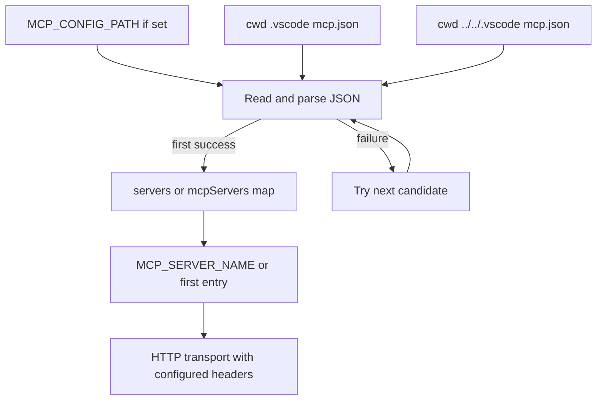

# Configuration, Deployment, and Validation

This is a pnpm workspace with a Next.js web application in `apps/web` and a streamable-HTTP MCP service in `apps/mcp`. Configuration is intentionally distributed by runtime boundary: the web app owns its database, RAG, internet-search, and outbound MCP-client settings; the MCP service owns connector credentials and listener settings. Local `.env` files are ignored, while `.env.example` only supplies the web database URL, so operators must provision the other required integration secrets themselves.

Related background: [system overview](../architecture/system-overview.md), [persistence and schema](../concepts/persistence-and-schema.md), and [MCP service and connectors](../integrations/mcp-service-and-connectors.md).

## Workspace entrypoints

Install from the repository root:

```bash
pnpm install
```

The root scripts delegate to named workspace packages. Use these from the repository root:

| Objective | Command | What it runs |
| --- | --- | --- |
| Develop the web app | `pnpm dev:web` | `next dev` in `@deepagents/web`; the documented local UI is `http://localhost:3000`. |
| Build the web app | `pnpm build:web` | `next build` in the web package. |
| Lint the web app | `pnpm lint:web` | `eslint` in the web package. |
| Start the MCP service | `pnpm mcp:server` | The MCP package's `node server.mjs` development command. `pnpm dev:mcp` is an equivalent root alias. |
| Run the standalone MCP client | `pnpm mcp:example` | The MCP package's client example. |

There is no root `test` script, and the MCP package's `test` script is a standalone live client (`node client.mjs`), not an automated test runner. The web package exposes build and lint scripts but no test script. Thus build/lint plus targeted, credentialed smoke tests are the repository-provided validation surface; they do not establish connector correctness without actually reaching the selected services.

## Local database and pgvector

The tracked example at `apps/web/.env.example` points `DATABASE_URL` at a local PostgreSQL instance on host port 5433. Its companion Compose file runs `pgvector/pgvector:pg17`, maps `5433:5432`, persists the cluster in the named `deepagents-pgvector-data` volume, and exposes a `pg_isready` health check. Start it before importing code that creates the Prisma client:

```bash
docker compose -f docker-compose.pgvector.yml up -d
cp apps/web/.env.example apps/web/.env
```

The Prisma configuration loads dotenv and takes its datasource URL from `DATABASE_URL`; the runtime client separately fails fast if the variable is absent, builds a `pg` pool, and supplies it through the Prisma PostgreSQL adapter. In non-production it caches the Prisma client on `global` to avoid repeatedly creating it during development reloads.

The database must be PostgreSQL with the `vector` extension available, not merely an arbitrary Postgres instance. The pgvector migration creates that extension, declares a required `vector(1024)` embedding column, and creates an HNSW cosine index. Apply the committed migrations to the intended database before exercising persistence/vector-dependent features; the repository provides the Prisma config and migrations but no root migration script. A practical package-scoped invocation is:

```bash
pnpm --filter @deepagents/web exec prisma migrate deploy
```

Use production-grade credentials and network controls outside local development: the Compose username/password are development defaults, and its named volume retains state across container restarts.

## Environment-variable ownership

Keep secrets in the environment or ignored app-local `.env` files, never in MCP tool arguments or generated exports. `dotenv/config` is imported by the MCP entrypoint/client, the Prisma config, and the RAG module; Next.js supplies its normal environment handling for the web process.

| Boundary | Variables | Behavior and operational consequence |
| --- | --- | --- |
| Web database | `DATABASE_URL` | Required by the Prisma runtime client and Prisma configuration. The checked-in example targets local pgvector at `localhost:5433`. |
| Web RAG | `PINECONE_API_KEY` | Required whenever the RAG code initializes or indexes the fixed `aoe-langchain-docs` Pinecone index. Missing it throws; indexing uses `documents` and `rag-manifest` namespaces and OpenAI embeddings, so the runtime also needs the provider credentials expected by `OpenAIEmbeddings`. |
| Web internet search | `TAVILY_API_KEY` | Passed to `TavilySearch` when the internet-search tool is invoked. |
| Web outbound MCP selection | `MCP_CONFIG_PATH`, `MCP_SERVER_NAME` | The first chooses configuration-file priority; the second chooses a named configured server, otherwise the first configured server is selected. |
| MCP listener | `PORT`, `MCP_PORT`, `MCP_HOST` | Listener precedence is `PORT`, then `MCP_PORT`, then `8787`; host defaults to `0.0.0.0`. The container sets `PORT=8080` and `MCP_HOST=0.0.0.0`. |
| Standalone MCP client | `MCP_SERVER_URL`, `JIRA_ISSUE_KEY`, `WIKI_CONTENT_ID` | The client defaults to `http://127.0.0.1:8787/mcp`; the latter two only provide default sample input when no positional argument is given. |
| Jira connector | `JIRA_BASE_URL`, `JIRA_BEARER_TOKEN` | Both are required before it performs bearer-authenticated Jira requests. |
| Slack connector | `SLACK_MCP_URL` | Optional override for the configured remote Slack MCP endpoint. The tool itself still requires keywords or a filter. |
| Confluence/wiki connector | `WIKI_BASE_URL`, `WIKI_AUTH_TYPE`, `WIKI_BEARER_TOKEN`, `WIKI_USERNAME`, `WIKI_PASSWORD`, `WIKI_OUTPUT_DIR` | Base URL defaults to the Cvent wiki; authentication defaults to bearer and requires its bearer token, or can be `basic` with both username and password. Exported files go to `WIKI_OUTPUT_DIR` or the process working directory. |

### MCP configuration-file resolution

The web app does **not** read `MCP_SERVER_URL`. Its MCP client loads JSON and accepts either a top-level `servers` or `mcpServers` map. It attempts locations in this order and returns the first readable, parseable JSON file:

1. The explicit `MCP_CONFIG_PATH` value.
2. `.vscode/mcp.json` under the process current working directory.
3. `../../.vscode/mcp.json` relative to that directory.

If an earlier file is missing or malformed, loading continues to the next candidate; if none succeed, it throws the last read/parse error. An empty server map, unknown selected server, or a type other than HTTP is also an error. The tracked `.vscode/mcp.json` configures `deepagents-local-mcp` as HTTP at `http://127.0.0.1:8787/mcp`. Headers in the selected JSON entry are copied into the HTTP transport request initialization.



This shows the web MCP client's ordered file lookup and subsequent server selection.

## MCP service and container behavior

The service creates a fresh `McpServer` and stateless `StreamableHTTPServerTransport` for every `POST /mcp`; it registers Jira, Slack, and wiki tools, connects the transport, then closes transport and server when the response closes. This simplifies local/demo HTTP calls but does not retain an MCP session across requests. `GET /` is the health endpoint and returns HTTP 200 with `{ "status": "healthy" }`; `GET /mcp` and `DELETE /mcp` explicitly return JSON-RPC method-not-allowed responses. Request handling failures are logged and, when headers have not already been sent, returned as JSON-RPC internal errors.

Build and run the independently packaged MCP image from the repository root:

```bash
docker build -f apps/mcp/Dockerfile apps/mcp -t deepagents-mcp
docker run --rm -p 8080:8080 deepagents-mcp
```

The Docker build context is deliberately `apps/mcp`, not the monorepo root. The multi-stage Dockerfile installs only production dependencies from the MCP package manifest using pnpm 11.2.2, copies `server.mjs`, `client.mjs`, and `package.json`, switches to the non-root `node` user, exposes port 8080, and starts `node server.mjs`. It defines a health check that requests `/` on its own configured port every 10 seconds after a 10-second start period. The `.dockerignore` excludes `.env`, so connector secrets must be injected at container runtime or by the deployment platform; they are not baked into this image.

For a local MCP smoke test, start the server, then run the live client from `apps/mcp`:

```bash
pnpm mcp:server
cd apps/mcp
pnpm test list
```

The documented local endpoint is `http://127.0.0.1:8787/mcp`. To test a container, use `MCP_SERVER_URL=http://127.0.0.1:8080/mcp pnpm test list`. Tool calls require the corresponding live credentials/connectivity; `list` is the narrowest credential-free protocol check. `curl http://127.0.0.1:8080/` is an even narrower container health check.

## RAG operational boundaries

RAG ingestion is started by `POST /api/manage/rag`. It accepts a non-empty docs folder selector and permits only one in-process index operation at a time: a concurrent request receives HTTP 409, and the promise is cleared in `finally` after success or failure. The selected path is normalized and rejected if it escapes `./docs`; local reads exclude `docs/remote`, while remote scopes consume JSON metadata `sources` arrays and fetch their URLs. Selecting the root docs scope includes both local files and remote documents.

Indexing skips source content whose SHA-256 hash matches the corresponding manifest record. Changed documents are split into 1,000-character chunks with 200-character overlap, old chunk IDs are deleted, new chunks are written in batches of eight with a 10-second inter-batch delay, and the source hash/chunk IDs are stored in the manifest. This means rerunning the same scope is incremental rather than a blind append; a failed run can still have completed writes for earlier documents. The fixed Pinecone index/embedding dimensionality is coupled to the 1024-dimensional application vector schema, but Pinecone RAG storage is distinct from the local pgvector database.

## Deployment automation status

### Cloud Run workflow is a template, not a production deployment

`.github/workflows/google-cloudrun-source.yml` is named as a source deployment workflow, but it is not production-ready as committed:

- Its branch filter is the literal quoted string `'"main"'`, not a normal `main` branch name.
- `PROJECT_ID`, `REGION`, and `SERVICE` are placeholder values (`my-project`, `us-central1`, and `my-service`).
- The Workload Identity Provider is an example resource name and is marked TODO.
- The source is repository root (`./`), although the deployable MCP Dockerfile and service live under `apps/mcp`; no Cloud Run service configuration, injected connector secrets, database connectivity, or post-deploy verification is supplied here.

It does request `id-token: write`, authenticates with Google Workload Identity Federation, and invokes the pinned `deploy-cloudrun` action. Before relying on it, correct the trigger and placeholder values, choose/build the intended service source, grant the documented Google roles/APIs, inject required runtime configuration securely, and verify the deployed `/` health endpoint plus a real MCP operation.

### OpenWiki automation

The OpenWiki workflow supports manual dispatch and a daily `0 8 * * *` schedule. It checks out full history because incremental OpenWiki updates compare against the previous documented commit, sets up Node 22, installs pinned OpenWiki/Mermaid/jsdom versions, and runs `openwiki code --update --print`. It supplies OpenAI and optional LangSmith-related secrets through workflow environment variables.

The OpenWiki command is allowed to fail temporarily so completed pages can still be proposed: the workflow removes `openwiki/.run.json`, creates/updates an `openwiki/update` pull request containing only OpenWiki-related paths, and then exits nonzero if the documented run failed. A failure PR therefore represents partial documentation progress, not a successful end-to-end documentation refresh.

## Focused validation playbook

Prefer the narrowest command that exercises the change and retain full output if it fails.

1. **Web source/style changes:** run `pnpm lint:web`; for build-time integration confidence run `pnpm build:web`. The build may require the environment values reached by imported application code.
2. **Database/schema changes:** start the Compose database, apply migrations, then use `pnpm --filter @deepagents/web exec prisma migrate status` and exercise the affected API with `DATABASE_URL` set. Confirm the pgvector extension/index using the database tooling appropriate to the target environment.
3. **MCP transport/container changes:** run the local server, use `pnpm test list` from `apps/mcp`, and check `/`. For an actual connector modification, call precisely that tool against a non-production-safe target with its required credentials.
4. **MCP configuration changes:** point `MCP_CONFIG_PATH` at the candidate JSON and exercise the RAG endpoint/agent initialization, including its expected failure cases for malformed JSON, empty maps, unknown names, and non-HTTP transports.
5. **RAG changes:** use a small selected docs folder and call `POST /api/manage/rag`; verify one accepted run, a concurrent 409 response, and the returned indexing counts. This requires external Pinecone and embedding-provider access, so it is an integration check rather than a hermetic test.
6. **Workflow changes:** validate YAML/action configuration in CI and, after configuring a real Cloud Run target, manually dispatch or use a safe branch event; check the deployed health endpoint and service logs. Do not treat static workflow presence as evidence of deployment.

No first-party unit or integration test suite is configured in the inspected package manifests. The commands above are practical checks, not substitutes for tests; adding behavior with nuanced parsing, failure handling, or external integration should include focused automated coverage where a suitable test harness is introduced.
