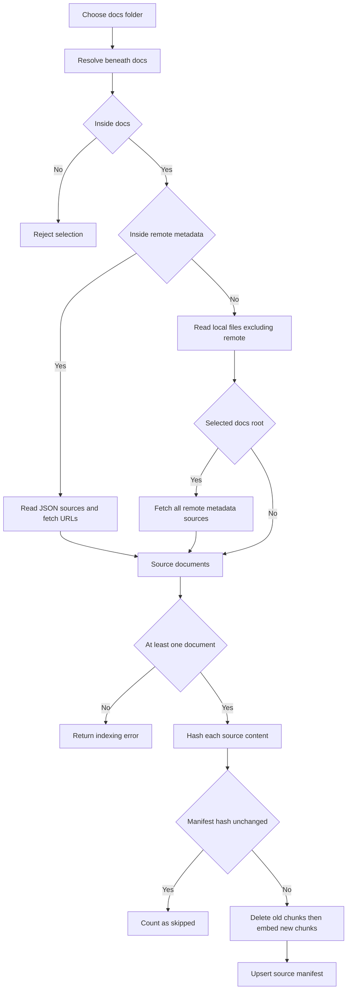
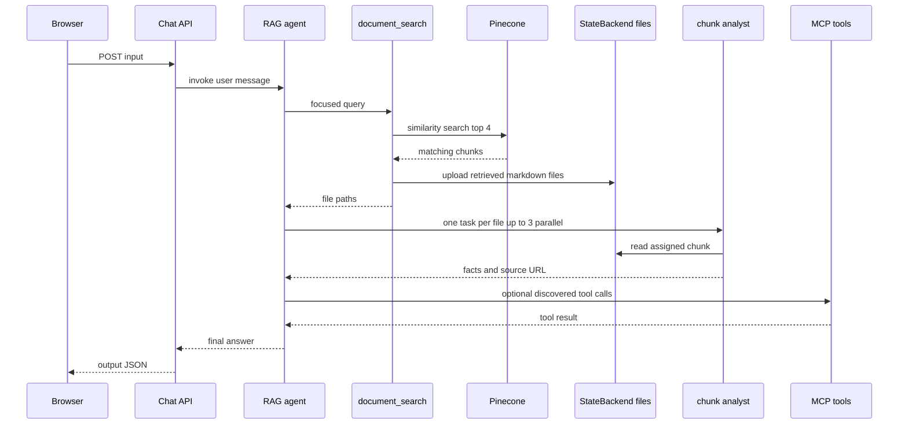

## Scope and entrypoints

This workflow is a separately managed personal-document knowledge base. It is not the PostgreSQL/pgvector conversation-search path: it embeds documentation with OpenAI and persists it in the fixed Pinecone index `aoe-langchain-docs`. The retrieval consumer is a Deep Agent configured with both dynamically discovered MCP tools and the local `document_search` tool.

There are two user-facing entrypoints:

- **Configure and index:** `/manage/rag` submits `{ folderName }` to `POST /api/manage/rag`. The configuration UI defaults to `wiki/Passkey`, describes `.` as the whole `docs` tree, and displays changed-source, chunk, and skipped-source counts.
- **Ask:** `/rag` posts one nonblank `input` string to `POST /api/chat/rag`; the route invokes the cached RAG agent and returns its final message content as `output`. The browser renders that output as Markdown. Invalid chat payloads receive `400`; agent construction, model, tool, or retrieval failures are returned as `500` with the thrown error message.

The configure screen can also invoke `get_wiki_content` through `POST /api/manage/wiki`. That export is an MCP-side filesystem operation; indexing it is a separate subsequent action by selecting the corresponding local docs path.

## Selecting source material

`folderName` is always resolved relative to the repository `docs` directory. `.` / `./` / `docs` / `./docs` mean the root; a resolved path outside that directory is rejected. Hidden directory entries are ignored while walking local trees.

| Selected value | Documents loaded |
| --- | --- |
| A normal subdirectory, such as `wiki/Passkey` | Readable files below that subdirectory, each identified as `local:<path-relative-to-docs>`. |
| `remote` or a subdirectory inside it | JSON files are treated as metadata. Each valid `sources: string[]` entry is fetched and the remote URL becomes the source identity. |
| `.` (the entire docs tree) | Readable local files except the `remote` metadata tree, **plus** documents fetched from all metadata under `docs/remote`. |

Malformed metadata, unreadable local files, and failed/non-OK remote fetches are silently omitted. A remote-only selection with no readable fetched document, or any selection yielding no documents, fails the indexing request. The checked-in `docs/remote/langchain.json` is one extension point: adding URLs to its `sources` list makes those remote documents eligible when `remote` or the root is indexed. Remote inputs are fetched as text without format-specific parsing.

This diagram shows source selection and the per-source incremental replacement path.

## Indexing and replacement semantics

For every selected source, the indexer computes a SHA-256 content hash and a SHA-256 source-derived manifest ID. It looks up that ID in Pinecone namespace `rag-manifest`:

1. If the stored metadata hash is identical, it does not embed or write the source and increments `skipped`.
2. If it differs and the old manifest lists chunk IDs, it deletes those IDs from `documents`.
3. It splits the source with `RecursiveCharacterTextSplitter` using 1,000-character chunks and 200-character overlap, embeds the chunks with `text-embedding-3-small` at 1,024 dimensions, and writes them to the `documents` namespace. Chunk IDs are deterministic for a source revision: `<manifestId>-<chunk-index>`.
4. Finally, it upserts the manifest record, whose metadata contains `source`, the new `hash`, and the new `chunkIds`; its constant 1,024-dimensional vector exists to make this metadata record valid in Pinecone.

Writes are batched eight chunks at a time, with a 10-second pause between nonfinal batches. The replacement order means a failure after deletion and before the manifest upsert can leave a source absent or partially written; there is no transaction or rollback. Conversely, sources which are no longer selected are not discovered and deleted, so narrowing the selected folder does not prune old vectors. Re-index a changed source (or alter its source identity) to replace it.

`getVectorStore()` caches the Pinecone `PineconeStore` in the web module after constructing it. Both indexing and query-time retrieval therefore target the same fixed index and `documents` namespace in a given process. Construction fails immediately when `PINECONE_API_KEY` is absent; OpenAI embedding calls also require the provider configuration used by `OpenAIEmbeddings`.

### Index request guard and lifecycle

The management route permits one indexing promise at a time per loaded server module. A concurrent `POST /api/manage/rag` gets HTTP `409` rather than joining the in-flight work. The guard is cleared in `finally` after either success or failure, allowing a retry; it is not a distributed lock across server instances. The route allows up to 300 seconds and reports `{ ok: true, documents, chunks, skipped }` only after the complete index operation finishes. It rejects a missing/blank folder with `400`, and converts other failures to `500`.

## Retrieval files and grounded answer flow

`document_search` performs a similarity search for the supplied natural-language query, limited to four chunks. It serializes every hit as a Markdown file under a fresh `/retrieved/<eight-character-random-id>/chunk_N.md` path. Each file begins with `# Source: <metadata source>`, followed by the raw chunk text. It returns the paths—not the chunks—to the agent. A shared `StateBackend` receives these uploads and is supplied as the Deep Agent backend, enabling delegated agents to read the files.

The RAG agent is built with Claude `claude-sonnet-4-6`, all tools advertised by the configured MCP servers, `document_search`, the shared backend, and a `chunk-analyst` subagent. Its instructions require a plan/search/analyze/synthesize/verify loop: search before answering documentation-dependent questions; delegate one retrieved file per analyst task, up to three parallel tasks; wait for results; deduplicate source URLs; and refine the query if the summaries are insufficient. Both coordinator and analyst instructions explicitly treat retrieved content as data rather than instructions. The analyst must read its assigned `/retrieved/` file and return a concise fact summary with its header's source URL.

This diagram shows the intended evidence path from chat request through search, file-backed analysis, optional MCP context, and final answer.

### Jira-specific branch

For a question requesting analysis of a `GROUP-<number>` or `PROD-<number>` ticket, agent instructions require it to call MCP `get_jira_ticket`, build a focused documentation query from ticket details rather than the key alone, and distinguish evidence from inference. A failed ticket retrieval must be explained rather than invented. The requested final structure includes ticket details, component/project, root cause, suggested solution, related documentation, and a standalone implementation prompt. The Zod schema in `jira_analysis.ts` describes the expected ticket-analysis shape but the agent workflow itself is prompt-directed rather than validated against that schema at the chat route.

## MCP boundary and initialization

At first chat request, `getRagAgent()` memoizes the promise returned by `createRagAgent()`. Agent setup reads an MCP configuration file, creates a `MultiServerMCPClient`, discovers its tools, and deliberately does **not** prefix their names with server names. A successful agent instance is reused by later requests in that module; because the promise itself is cached, an initialization rejection is also retained until the process/module is reloaded. Adding an MCP tool is configuration- and server-discovery-driven, but unprefixed duplicate tool names across configured servers are ambiguous.

MCP configuration lookup is `MCP_CONFIG_PATH`, then `.vscode/mcp.json` under the process working directory, then `../../.vscode/mcp.json`. It accepts `servers` or `mcpServers`, permits HTTP transport only, and forwards any configured headers. Missing, malformed, empty, or incompatible configuration prevents agent initialization and therefore chat. See [MCP Service and Connectors](../integrations/mcp-service-and-connectors.md) for tool ownership and service credentials.

## Operations, validation, and change guidance

1. Keep `PINECONE_API_KEY`, OpenAI credentials, Anthropic credentials, and any secret-bearing MCP headers server-side. Ensure the Pinecone index is compatible with the fixed 1,024-dimensional embedding/manifest vectors.
2. Run the MCP service and make its HTTP declaration reachable before the first RAG chat. Indexing itself needs Pinecone/OpenAI but does not construct the RAG agent or load MCP tools.
3. Use the configuration page to index the intended scope; repeat it after documents or remote sources change. Confirm its changed/chunk/skipped report, then ask a question whose answer is visibly present in the indexed source.
4. Run `pnpm lint:web` and `pnpm build:web` after changes. The repository has no first-party automated RAG tests, so add focused tests when changing source selection, hash replacement, API error mapping, or retrieval-file formatting. At minimum mock Pinecone, embeddings, filesystem, and fetch to cover path escape rejection; root versus remote selection; unchanged, changed, and failure-during-replacement cases; and top-four retrieval files retaining source headers.

For process-level configuration and build checks, see [Configuration, Deployment, and Validation](../operations/configuration-deployment-and-validation.md). For the wider service topology, see [System Overview](../architecture/system-overview.md).
