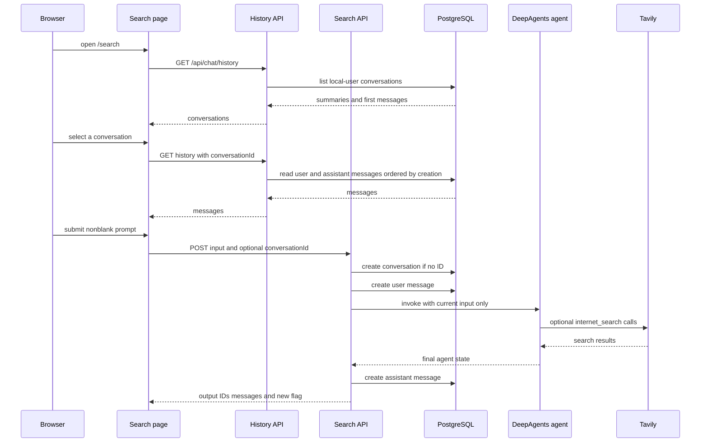
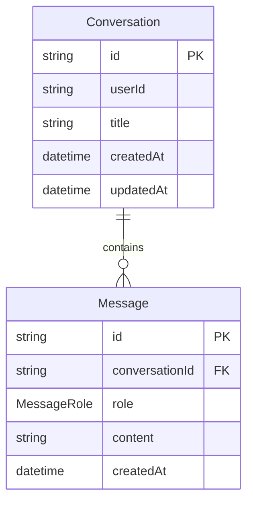

## Scope and entry points

The `/search` client page is a persisted, request-response web-search chat rather than a streaming chat or a multi-turn agent session. It owns browser-side input, displayed messages, the selected conversation ID, sidebar history, loading state, and a synthetic welcome message. On mount it fetches conversation summaries from `GET /api/chat/history`; selecting a sidebar entry fetches its messages; and submitting a nonblank prompt posts to `POST /api/chat/search`. Assistant content is rendered as Markdown with GFM support, while user content is rendered as plain text.

A new chat is only a client-state reset: it clears `activeConversationId` and restores the welcome message. No conversation row is created until the first successful search request. Conversely, loading a conversation sets the active ID before the history request completes; a failed history request replaces the display with the welcome message while retaining that selected ID.



This sequence shows the implemented non-streaming request lifecycle. The agent receives the submitted input only, not the persisted prior messages.

## Search submission lifecycle

`POST /api/chat/search` accepts JSON with a trimmed, nonempty `input` and an optional CUID `conversationId`. A schema validation failure returns `400` with `Invalid payload` and flattened Zod details; an invalid JSON body instead reaches the outer error handler and returns `500`. The route then follows this order:

1. If no ID was supplied, it creates a `Conversation` under the default `local-user` identity. Its title is the first prompt, capped at 60 characters plus `...` when longer, and the response marks `isNewConversation: true`. If an ID was supplied, the route simply uses it and marks the result as not new.
2. It writes the user message **before** invoking the agent.
3. It invokes the process-level `searchAgent` with one user message containing the new input. It does not load, send, or otherwise use earlier messages as model context.
4. It takes the final item in `result.messages`, converts either a string or an array of strings/text blocks to trimmed text, and uses `No response received.` if that conversion is empty.
5. It writes an assistant message and returns `output`, the conversation ID, the new-conversation flag, and both saved messages.

The user-message write and agent call are not a transaction. Therefore, if the model/search path fails, the user message remains and the route writes the fixed fallback assistant reply. If a database operation, request parsing, or assistant-message write fails outside that inner agent `try` block, the route returns HTTP 500; it does not manufacture a client-visible successful turn. A supplied but nonexistent conversation ID passes route validation but fails when the message foreign key is enforced.

The page prevents a second submit while its `loading` state is true, clears the input before the fetch, and appends the server-returned saved messages rather than constructing them locally. On a non-OK response or network error, it appends a local ephemeral fallback assistant bubble; that bubble is not persisted. When the server reports a new conversation, the page prepends an optimistic sidebar summary, but it does not refresh an existing conversation summary after later turns.

## Research agent and external search boundary

`searchAgent` is created once at module load with `createDeepAgent`. It uses `ChatAnthropic` configured for `claude-haiku-4-5-20251001`, a researcher-oriented system prompt, and one tool: `internet_search`. The tool is a LangChain `tool` wrapping a newly constructed `TavilySearch` for each invocation. Its schema exposes a query plus optional `maxResults` (default 5), `topic` (`general`, `news`, or `finance`, default `general`), and `includeRawContent` (default false); it passes `TAVILY_API_KEY` to Tavily.

This is an agent-mediated tool boundary: the route asks DeepAgents for a response, and the model decides whether and how to call the available tool. The application does not itself issue a Tavily request for every prompt, does not persist Tavily results/tool traces, and does not return citations as a separately structured API field. Anthropic, Tavily, and tool failures can reach the route's inner catch; the externally observable outcome is the persisted fallback assistant text rather than an error HTTP response. A successful agent invocation whose final content cannot be normalized instead persists `No response received.`.

## History API and current trust boundary

`GET /api/chat/history` has two modes:

| Request | Database operation | Response |
| --- | --- | --- |
| No `conversationId` query parameter | Lists `local-user` conversations by `updatedAt` descending, including at most the first message ordered by `createdAt` ascending | `{ conversations }` |
| Any nonempty `conversationId` query parameter | Reads that conversation's messages where role is `user` or `assistant`, ordered by `createdAt` ascending | `{ messages }` |

Unlike the search route, the history `GET` does not validate the query ID as a CUID. It also does not check that a requested conversation belongs to `local-user` (or any authenticated principal); it filters only by `conversationId`. The route's `POST` is a separate direct message-creation API. It validates an optional CUID ID, role limited to `user` or `assistant`, and trimmed nonempty content; it rejects a missing ID with HTTP 400, otherwise inserts exactly the caller-supplied message and returns it with HTTP 201.

There is no authentication or authorization in either route. `DEFAULT_USER_ID` is the constant `local-user`, used when creating and listing conversations, while a client-provided existing conversation ID is trusted after syntactic validation in the search and history-POST paths. As a result, this is a local/demo ownership convention, not a tenant isolation mechanism: a caller that knows another valid ID can read its history through `GET` and append a turn through either message-creating route. A production multi-user change needs an authenticated identity and ownership-constrained reads/writes, rather than relying on CUID opacity.

## PostgreSQL model and lifecycle

Conversation history is stored through Prisma, backed by a `pg` pool and `PrismaPg` adapter. Loading the database module requires `DATABASE_URL`; without it, the module throws before database access. The Prisma client is cached on `global` outside production to reduce development hot-reload client creation.



This diagram shows the relational ownership of persisted search history. The application history APIs expose only `user` and `assistant` messages even though the schema enum also has `system` and `tool` values.

`Conversation` uses CUID primary keys, stores a required user ID, optional title, and creation/update timestamps. `Message` also uses CUIDs, has required content and a required conversation reference, and is indexed with its conversation ID and creation time. Deleting a conversation cascades to its messages. The conversation index on `(userId, updatedAt)` supports default-user listing, and the message index on `(conversationId, createdAt)` supports chronological reads.

An important current ordering limitation is that `createMessage()` inserts only a child row; it does not update its parent `Conversation`. Since Prisma's `@updatedAt` is advanced when the parent record is updated, subsequent message writes do not necessarily move a conversation in `listConversations()` ordering. The sidebar's initial ordering is therefore creation/last direct conversation update order, not reliably last-message order. Updating the parent as part of turn persistence is required if recency-by-message is a product invariant.

## Failure behavior and safe extension points

- **Client history failures:** initial sidebar failure leaves an empty sidebar; selected-history failure shows the welcome message. Neither path displays a server error detail.
- **Search service failures:** an agent/tool/model failure is intentionally converted to a persistent assistant fallback. A fetch-level failure produces a visually similar local fallback, but without a database row.
- **Persistence failures:** message foreign keys prevent orphan messages, and the outer route handler returns error text with HTTP 500. Because turn writes are not transactional, partial persistence is possible: most notably, a user message can exist without an assistant message.
- **Response shape:** the client depends on returned `userMessage` and `assistantMessage` to append a completed turn. Preserve those fields, or update the optimistic UI protocol together with the route.
- **Conversation context:** adding multi-turn model context should be an explicit design change. At present, history is a UI/persistence feature only; replaying it into `searchAgent.invoke()` would change both provider payload size and answer behavior.
- **Authorization:** the natural extension boundary is the DB helper/query layer and both route handlers. Apply actor ownership to list, read, create, and append queries consistently; validating an identifier format alone is not authorization.

## Configuration and focused validation

The web process needs `DATABASE_URL` for these routes to load. The model path also needs Anthropic credentials as required by `ChatAnthropic`, and actual web searches need `TAVILY_API_KEY`. The supplied local database setup uses `pgvector/pgvector:pg17` on host port `5433`; chat history itself uses ordinary relational tables, while the pgvector capability is used by separate resume-related schema/features. Apply the committed Prisma migrations before exercising chat persistence:

```bash
docker compose -f docker-compose.pgvector.yml up -d
cp apps/web/.env.example apps/web/.env
pnpm --filter @deepagents/web exec prisma migrate deploy
pnpm lint:web
pnpm build:web
```

No repository-owned web test script is configured, so route behavior requires targeted integration coverage. At a minimum, test invalid payloads, creation versus an existing ID, chronological history reads, cascade deletion, and the foreign-key failure for an absent ID. Mock `searchAgent.invoke()` to cover string, text-block-array, empty-output, and thrown-error outcomes; assert the user and fallback assistant records are written for the thrown case. Also test that a message append does not advance `Conversation.updatedAt` if sidebar recency matters, and add authorization regression tests before exposing this endpoint to multiple users.

## Related documentation

- [System Overview and Runtime Boundaries](../architecture/system-overview.md) places the web search agent and its Anthropic/Tavily dependencies in the broader runtime.
- [Persistence, Vector Stores, and Data Ownership](../concepts/persistence-and-schema.md) covers migrations, database configuration, and the distinction between conversation history and other stores.
- [Configuration, Deployment, and Validation](../operations/configuration-deployment-and-validation.md) provides workspace-level environment and operational guidance.
